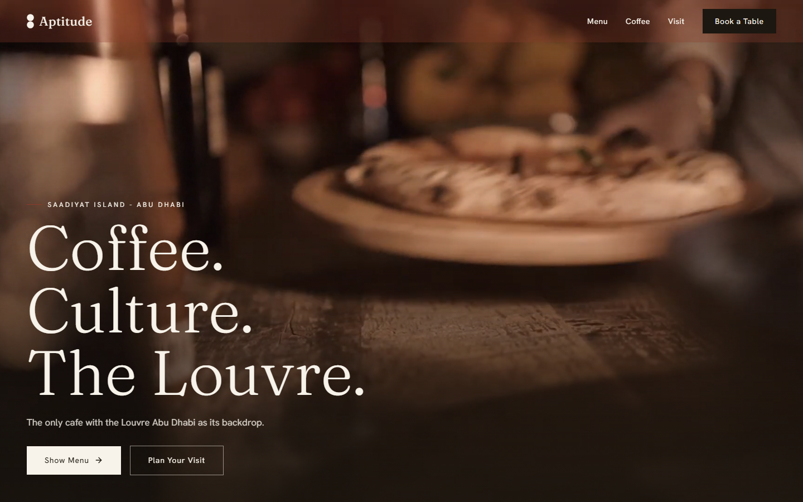

# Aptitude Cafe

[](https://aptitude.farukportfolio.live)


Concept website for Aptitude, a specialty coffee shop in the Louvre Abu Dhabi park on Saadiyat Island.

> **Concept site.** An unofficial study I designed and built to practise hospitality web design. It was not commissioned by Aptitude and is not affiliated with it. The cafe's name and brand belong to its owners.

**Live:** [aptitude.farukportfolio.live](https://aptitude.farukportfolio.live)



## Features

- Video hero with a staggered headline reveal
- Separate `/menu` page
- Scroll-driven text that fills with color as you read
- Animated number counters and a looping marquee
- Magnetic buttons that follow the cursor
- Visit section with hours and location
- Smooth scroll with Lenis, synced to GSAP ScrollTrigger

## Stack

- Next.js 16 (App Router), React 19, TypeScript
- Tailwind CSS v4
- GSAP + ScrollTrigger
- Lenis
- Fraunces + Hanken Grotesk via `next/font`
- Lucide icons

## Run locally

```bash
npm install
npm run dev
```

Open http://localhost:3000.

## My role

Solo concept project: design and development.

## License

No license is granted for the code. All rights reserved by Farouk Battikh. Names, logos and brand assets of the cafe belong to its owners.
